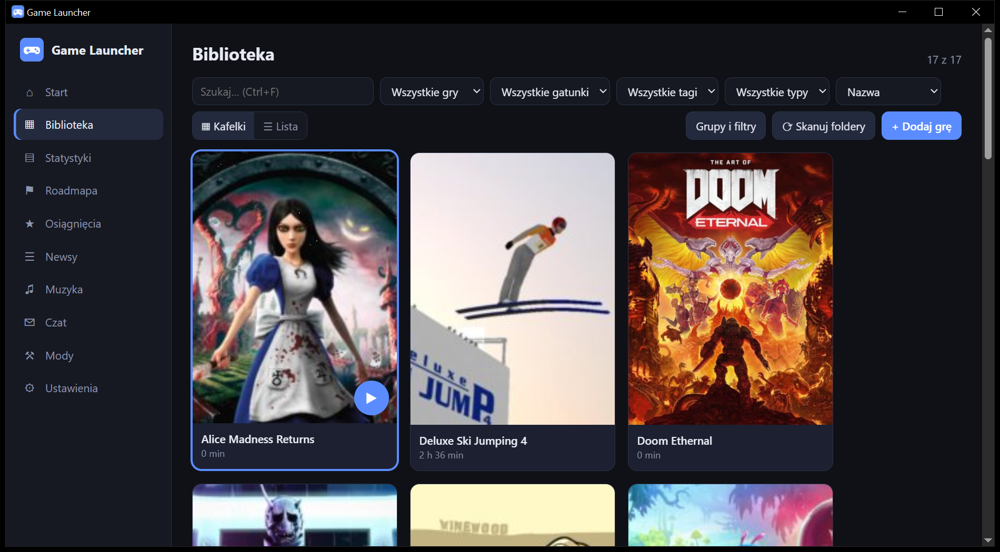
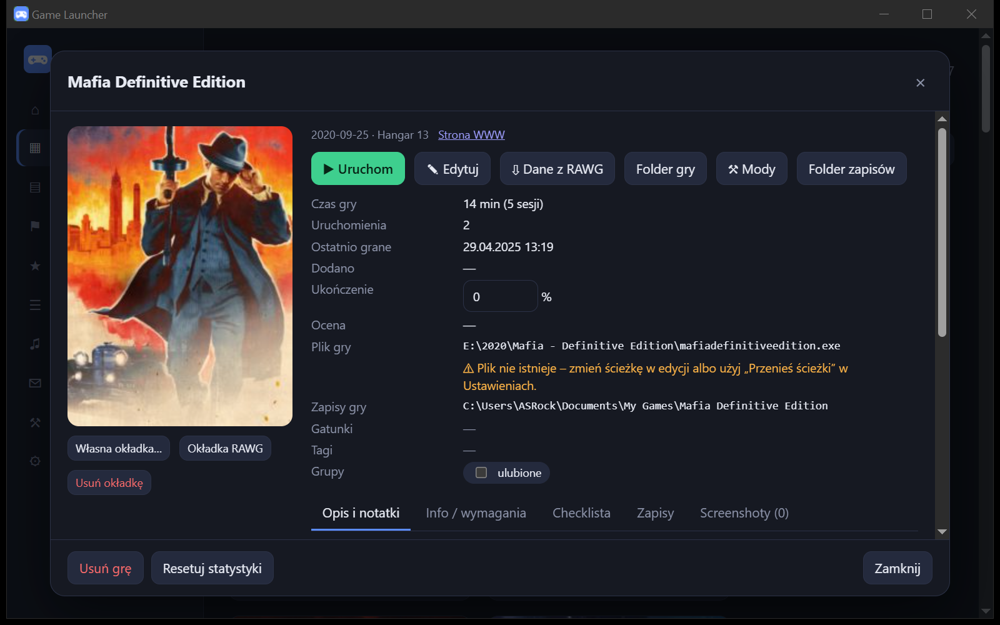
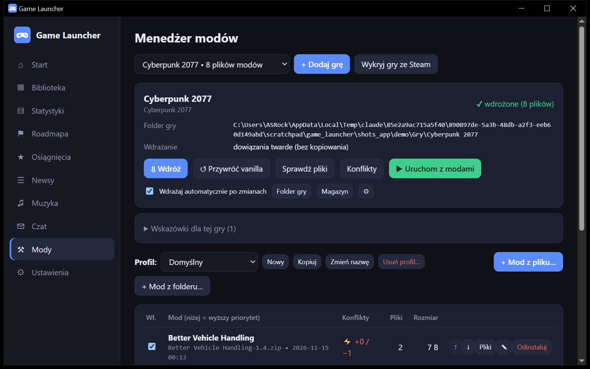
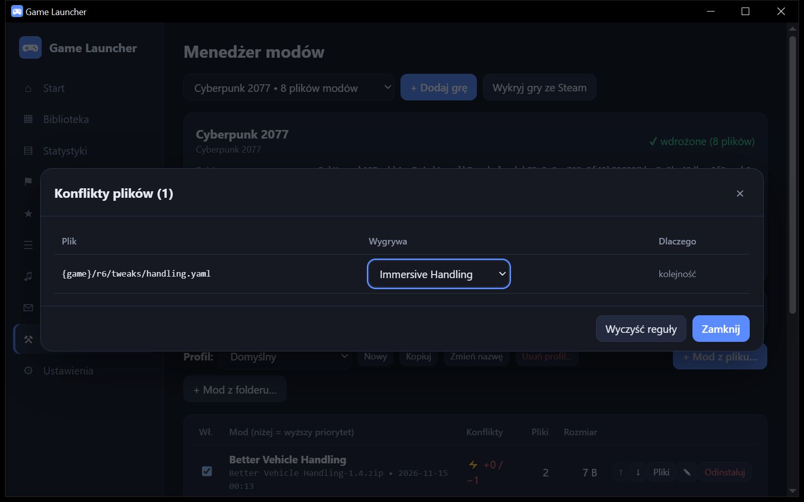
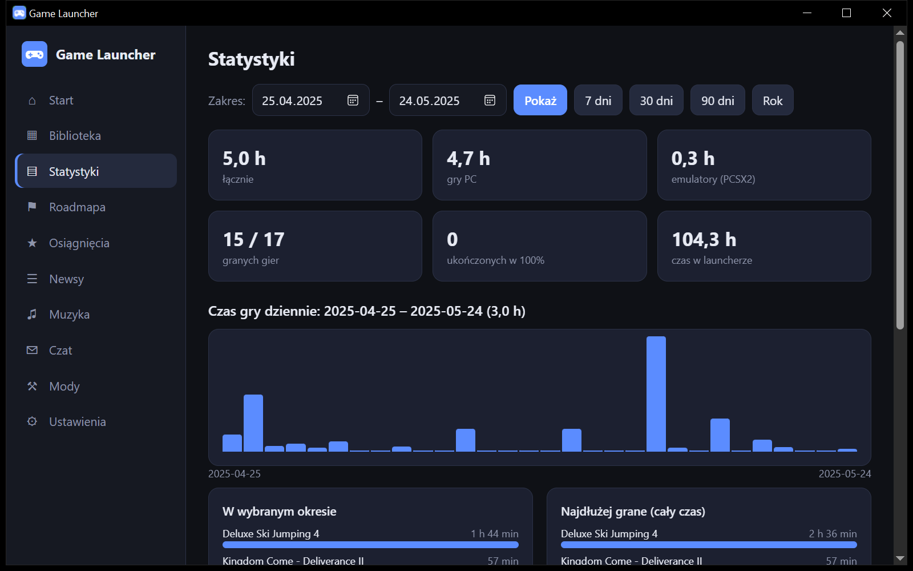
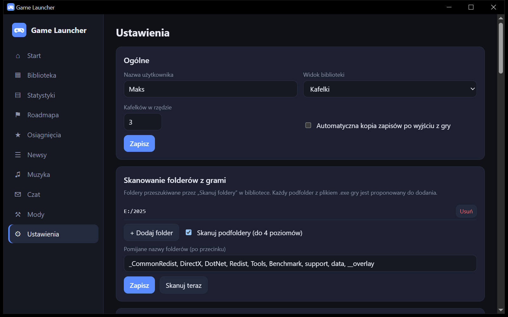

# 🎮 Game Launcher

[English](#english) | [Polski](#polski)

Game Launcher 2.0 is a rewrite in **Go + WebView2**: one `GameLauncher.exe` (~14 MB), starts in ~60 ms, reads the data of version 1.5.0 without conversion and adds a real **mod manager** (journaled deployment, conflicts, profiles, one-click return to vanilla).



---

<a name="english"></a>
## 🇬🇧 English

### 📑 Table of contents

- [Overview](#overview)
- [Screenshots](#screenshots)
- [Key features](#key-features)
- [Mod manager](#mod-manager)
- [Requirements](#requirements)
- [Installation](#installation)
- [Upgrading from 1.5.0 (Python)](#upgrading-from-150-python)
- [Configuration and secrets](#configuration-and-secrets)
- [Portable use](#portable-use)
- [Building from source](#building-from-source)
- [Tests](#tests)
- [Known limitations](#known-limitations)
- [License](#license)

### Overview

A launcher for a personal game collection – old classics, DRM-free and store games alike: library with covers, playtime and sessions, save backups, statistics, roadmap, achievements, music player, chat, web remote and a mod manager that keeps every game folder restorable. The UI is Polish.

The previous Python/Tkinter version (1.5.0) is still in the repository root (`game_launcher.py`) for reference, but it is no longer developed; releases from 2.0.0 on are the Go version in `go/`.

### Screenshots

| | |
|---|---|
|  |  |
|  |  |
|  |  |

### Key features

- 🎯 **Library**: tiles and list, search, groups, saved advanced filters, genres, tags, sorting, folder scan with a review dialog, emulators (`emulator [args] ROM`), launch profiles; editing never drops checklists, screenshots, RAWG data or stats.
- ⏱️ **Playtime**: sessions (also for games started outside the launcher), statistics for any date range, achievements (same rules as 1.5.0) with an editor.
- 💾 **Saves**: backups after the game exits, a save manager with a safety copy before restoring.
- 🗓️ **Roadmap** with deadlines, archive, reminders (system notifications).
- 🎵 **Music**: playlists, shuffle/repeat, Last.fm covers, global hotkeys (opt-in).
- 💬 **Chat**: server built into the launcher (or `glchat.exe`) and client – WebSocket, bcrypt, session tokens, rate limits, rooms, DMs, files.
- 🌐 **Web remote**: token, POST-only actions, localhost by default (LAN optional), own port 5050.
- ☁️ **Backup**: GitHub (always a private repository, diff-based upload), full `.zip` backup/restore.
- 🔄 **Updater**: newest release by semver, the right asset, mandatory SHA-256, exe swap with rollback.
- 🖥️ **System**: tray, autostart, Discord Rich Presence, keyboard and gamepad navigation, RSS news, duplicate finder, theme editor.

### Mod manager

Page **Mody** (also "⚒ Mody" in game details). Built-in definitions: Skyrim SE/AE, Fallout 4, Fallout New Vegas, Starfield, Morrowind, Valheim (BepInEx/Thunderstore), Minecraft Java, Stardew Valley (SMAPI), RimWorld, Baldur's Gate 3, Cyberpunk 2077, The Witcher 3, Doom source ports, Half-Life (GoldSrc), GTA San Andreas – and **"any game"** (copy into a folder) for everything else. Definitions are JSON; your own go into `data\modmgr\gamedefs\`.

- Mods live in a **store** outside the game (`data\modmgr\store`), installed from `.zip`, `.7z`, a folder or a single file (`.esp`, `.pak`, `.wad`, `.pk3`, `.jar`…). The archive layout is recognised (wrapper folders, `Data\` on top, Thunderstore packages, several SMAPI mods in one archive); a preview shows where every file goes and lets you choose the folder and type by hand.
- **Deployment** uses hardlinks (same drive) or copies. Every overwritten game file is backed up first; the plan is written to a journal before the first change, so a crash or power loss is finished or rolled back on the next start. **"Przywróć vanilla"** returns the folder bit-for-bit.
- **Conflicts** per file: the later mod wins, or you pick the winner of a single file. Identical files are shown separately.
- **Profiles** per game (switching is one transaction that changes only what differs).
- **Load order files**: `plugins.txt` (Skyrim/Fallout/Starfield formats), `Morrowind.ini` + plugin dates, Cyberpunk `modlist.txt`, Witcher 3 `mods.settings`, RimWorld `ModsConfig.xml`, Doom `-iwad/-file` arguments.
- **Game updates**: changed files are detected; the new game file becomes the new original, uninstalling after an update keeps it.
- **Safety**: nothing from an archive is ever executed; enabling a mod with code (DLL/ASI/scripts) and overwriting protected files need consent; no deployment while the game runs; unsafe archive paths (traversal, NTFS streams, reserved names, links, ZIP bombs) are rejected.

Details and the full design: [docs/MOD_MANAGER.md](docs/MOD_MANAGER.md).

### Requirements

- Windows 10/11 x64
- Microsoft Edge **WebView2 Runtime** (preinstalled on current Windows 10/11)

### Installation

1. Download `GameLauncher-<version>-windows-x64.exe` and `SHA256SUMS` from [Releases](https://github.com/snakex21/Game-Launcher/releases) and check the hash:
   `certutil -hashfile GameLauncher-2.0.0-windows-x64.exe SHA256`
2. Put the exe into the launcher folder (rename it to `GameLauncher.exe` if you like). Data is kept **next to the exe** in `data\`.
3. Optional flags: `-app-dir <folder>` (another data folder), `-minimized` (start in the tray), `-debug` (WebView2 dev tools).

### Upgrading from 1.5.0 (Python)

Put the exe into the folder of 1.5.0 (the one with `data\`, `images\`, `internal_music\`). No conversion step is needed:

| Data | In 2.0.0 |
|---|---|
| `data\config\config.json` | read and written in the same format (key order, unknown fields, number formatting and line endings kept); `config.json.bak` before the first save of a session; a broken file is set aside, never overwritten |
| `data\config\local_settings.json` | same format; **secrets** (API keys, GitHub token, remote token, chat passwords) are encrypted with **DPAPI** (`dpapi:<base64>`) on the first start – 1.5.0 cannot read them afterwards, and on another PC/user they must be entered again |
| `data\games_saves\…` | same layout |
| `config.json → mods_data` (old mod manager) | kept unchanged and shown read-only on the Mody page; the old manager copied files straight into the game, so to manage such a mod in 2.0 install it again from its archive/folder (its old backup is in the game's `_backup_…` folder) |
| `data\chat\chat.db` | new schema, a valid 1.5.0 database is upgraded (old passwords are rehashed with bcrypt at the next login); the Python chat client cannot connect to the new WebSocket server |
| new | `data\modmgr\` (mod manager), `data\webview2\` (browser profile), `data\go_cache\` (thumbnails), `data\logs\go_launcher.log` |

Back up `data\` before the first start if you want to be able to go back to 1.5.0.

### Configuration and secrets

API keys are entered in **Settings** and stored DPAPI-encrypted; they never reach the UI or the log. Environment variables win over the file and are never written: `GL_RAWG_API_KEY`, `GL_LASTFM_API_KEY`, `GL_GITHUB_TOKEN`, `GL_REMOTE_TOKEN`.

### Portable use

The app folder is the folder of the exe. Game paths on the launcher's drive are stored without the drive letter and resolve again after the letter changes (USB drive E: → F:). The WebView2 profile is kept in `data\webview2`, not in `%APPDATA%`. Mod manager data uses paths relative to named roots; game folders on the launcher's drive are portable too.

### Building from source

Go 1.26 (toolchain 1.26.11 is fetched automatically) and MinGW-w64 `gcc` (CGO for WebView2):

```bat
git clone https://github.com/snakex21/Game-Launcher.git
cd Game-Launcher\go
build.bat 2.0.0          :: build\GameLauncher.exe  (-trimpath -s -w -H windowsgui, icon + version info)
go build -trimpath -ldflags "-s -w" -o build\glchat.exe .\cmd\glchat
```

### Tests

```bat
cd go
go vet ./...
go test -race ./...
go run golang.org/x/vuln/cmd/govulncheck@v1.9.0 ./...
```

Mod manager tests use only fake games and generated mods in temporary folders (never real games or user folders). Manual checks before a release: [docs/TESTY.md](docs/TESTY.md). CI: `.github/workflows/go-ci.yml`.

### Known limitations

- Mod manager: no FOMOD wizard, no Nexus/Thunderstore/Modrinth downloads yet, RAR must be unpacked first, no symlinks/staging cache (a store on a USB drive and a game on another drive means copies), BG3 `modsettings.lsx` is not written. See [docs/MOD_MANAGER.md](docs/MOD_MANAGER.md).
- Google Drive backup was dropped (it never worked in 1.5.0); UI only in Polish.
- Game folders on a drive other than the launcher's drive need "Settings → Move paths" after their letter changes.

### License

**GNU General Public License v3.0** – see [LICENSE](LICENSE). You may use, modify and distribute the software; derivative works must stay open source under GPL-3.0.

This launcher is meant for personal game collections; you are responsible for having the rights to the games and mods you use.

---

<a name="polski"></a>
## 🇵🇱 Polski

### 📑 Spis treści

- [Opis](#opis)
- [Zrzuty ekranu](#zrzuty-ekranu)
- [Główne funkcje](#główne-funkcje)
- [Menedżer modów](#menedżer-modów)
- [Wymagania](#wymagania)
- [Instalacja](#instalacja)
- [Przejście z wersji 1.5.0 (Python)](#przejście-z-wersji-150-python)
- [Konfiguracja i sekrety](#konfiguracja-i-sekrety)
- [Praca z pendrive'a](#praca-z-pendrivea)
- [Budowanie ze źródeł](#budowanie-ze-źródeł)
- [Testy](#testy)
- [Znane ograniczenia](#znane-ograniczenia)
- [Licencja](#licencja)

### Opis

Launcher do własnej kolekcji gier – starych klasyków, gier bez DRM i ze sklepów: biblioteka z okładkami, czas gry i sesje, kopie zapisów, statystyki, roadmapa, osiągnięcia, odtwarzacz muzyki, czat, pilot WWW i menedżer modów, po którym każdy folder gry da się przywrócić do oryginału.

Wersja 2.0.0 to przepisany od zera launcher w **Go + WebView2**: jeden plik `GameLauncher.exe` (~14 MB), okno po ~60 ms, odczyt danych wersji 1.5.0 bez konwersji. Poprzednia wersja Python/Tkinter (1.5.0) zostaje w katalogu głównym repozytorium (`game_launcher.py`) tylko do wglądu i nie jest już rozwijana.

### Zrzuty ekranu

| | |
|---|---|
|  |  |
|  |  |
|  |  |

### Główne funkcje

- 🎯 **Biblioteka**: kafelki i lista, wyszukiwanie, grupy, zapisane filtry zaawansowane, gatunki, tagi, sortowanie, skanowanie folderów z oknem weryfikacji, emulatory (`emulator [argumenty] ROM`), profile uruchamiania; edycja nie gubi checklisty, screenshotów, danych RAWG ani statystyk.
- ⏱️ **Czas gry**: sesje (także gier uruchomionych poza launcherem), statystyki dla dowolnego zakresu dat, osiągnięcia (te same reguły co w 1.5.0) z edytorem.
- 💾 **Zapisy**: kopia po wyjściu z gry, menedżer kopii z kopią bezpieczeństwa przed wczytaniem.
- 🗓️ **Roadmapa** z terminami, archiwum, przypomnienia (powiadomienia systemowe).
- 🎵 **Muzyka**: playlisty, losowo/powtarzanie, okładki z Last.fm, globalne skróty (po włączeniu).
- 💬 **Czat**: serwer wbudowany w launcher (albo `glchat.exe`) i klient – WebSocket, bcrypt, tokeny sesji, limity, pokoje, wiadomości prywatne, pliki.
- 🌐 **Pilot WWW**: token, akcje tylko przez POST, domyślnie tylko localhost (LAN opcjonalnie), port 5050.
- ☁️ **Kopie**: GitHub (zawsze prywatne repozytorium, wysyłanie różnicowe), pełna kopia `.zip` z przywracaniem.
- 🔄 **Aktualizator**: najnowsze wydanie wg semver, właściwy plik, obowiązkowe SHA-256, podmiana exe z wycofaniem.
- 🖥️ **System**: zasobnik, autostart, Discord Rich Presence, obsługa klawiaturą i padem, newsy RSS, wyszukiwarka duplikatów, edytor motywów.

### Menedżer modów

Strona **Mody** (także przycisk „⚒ Mody” w szczegółach gry). Wbudowane definicje: Skyrim SE/AE, Fallout 4, Fallout New Vegas, Starfield, Morrowind, Valheim (BepInEx/Thunderstore), Minecraft Java, Stardew Valley (SMAPI), RimWorld, Baldur's Gate 3, Cyberpunk 2077, Wiedźmin 3, Doom (source porty), Half-Life (GoldSrc), GTA San Andreas – oraz **„Dowolna gra”** (kopiuj do folderu) dla wszystkich pozostałych. Definicje to pliki JSON; własne wkłada się do `data\modmgr\gamedefs\`.

- Mody leżą w **magazynie** poza grą (`data\modmgr\store`); instalacja z `.zip`, `.7z`, folderu albo pojedynczego pliku (`.esp`, `.pak`, `.wad`, `.pk3`, `.jar`…). Układ archiwum jest rozpoznawany (foldery-opakowania, `Data\` na wierzchu, paczki Thunderstore, kilka modów SMAPI w jednym archiwum); podgląd pokazuje, gdzie trafi każdy plik, i pozwala ręcznie wskazać folder i typ.
- **Wdrażanie** dowiązaniami twardymi (ten sam dysk) albo kopiami. Każdy nadpisywany plik gry ma najpierw kopię; plan trafia do dziennika przed pierwszą zmianą, więc po awarii lub zaniku prądu operacja jest dokańczana albo wycofywana przy następnym starcie. **„Przywróć vanilla”** przywraca folder bit w bit.
- **Konflikty** na poziomie pliku: wygrywa późniejszy mod albo wskazany ręcznie zwycięzca pojedynczego pliku; identyczne pliki oznaczone osobno.
- **Profile** dla każdej gry (przełączenie to jedna transakcja, która zmienia tylko różnice).
- **Pliki kolejności**: `plugins.txt` (formaty Skyrim/Fallout/Starfield), `Morrowind.ini` + daty pluginów, `modlist.txt` Cyberpunka, `mods.settings` Wiedźmina 3, `ModsConfig.xml` RimWorlda, argumenty `-iwad/-file` Dooma.
- **Aktualizacje gier**: zmienione pliki są wykrywane; nowy plik gry staje się nowym oryginałem, a odinstalowanie moda po aktualizacji go zostawia.
- **Bezpieczeństwo**: nic z archiwum nie jest uruchamiane; włączenie moda z kodem (DLL/ASI/skrypty) i nadpisanie chronionych plików wymagają zgody; brak wdrażania przy uruchomionej grze; niebezpieczne ścieżki w archiwach (`..`, strumienie NTFS, nazwy zarezerwowane, linki, bomby ZIP) są odrzucane.

Szczegóły i pełny projekt: [docs/MOD_MANAGER.md](docs/MOD_MANAGER.md).

### Wymagania

- Windows 10/11 x64
- Microsoft Edge **WebView2 Runtime** (jest w aktualnym Windows 10/11)

### Instalacja

1. Pobierz `GameLauncher-<wersja>-windows-x64.exe` i `SHA256SUMS` z [Releases](https://github.com/snakex21/Game-Launcher/releases) i sprawdź sumę:
   `certutil -hashfile GameLauncher-2.0.0-windows-x64.exe SHA256`
2. Połóż exe w folderze launchera (możesz zmienić nazwę na `GameLauncher.exe`). Dane są trzymane **obok exe** w `data\`.
3. Opcje: `-app-dir <folder>` (inny folder danych), `-minimized` (start w zasobniku), `-debug` (narzędzia deweloperskie WebView2).

### Przejście z wersji 1.5.0 (Python)

Połóż exe w folderze wersji 1.5.0 (tym z `data\`, `images\`, `internal_music\`). Konwersja nie jest potrzebna:

| Dane | W 2.0.0 |
|---|---|
| `data\config\config.json` | odczyt i zapis w tym samym formacie (kolejność kluczy, nieznane pola, zapis liczb i końce linii zachowane); `config.json.bak` przed pierwszym zapisem w sesji; uszkodzony plik jest odkładany na bok, nigdy nadpisywany |
| `data\config\local_settings.json` | ten sam format; **sekrety** (klucze API, token GitHub, token pilota, hasła czatu) są przy pierwszym starcie szyfrowane **DPAPI** (`dpapi:<base64>`) – wersja 1.5.0 ich potem nie odczyta, a na innym komputerze/koncie trzeba je wpisać ponownie |
| `data\games_saves\…` | ten sam układ |
| `config.json → mods_data` (stary menedżer modów) | zachowane bez zmian, widoczne tylko do odczytu na stronie Mody; stary menedżer kopiował pliki prosto do gry, więc żeby zarządzać takim modem w 2.0, zainstaluj go ponownie z archiwum/folderu (stara kopia jest w folderze `_backup_…` gry) |
| `data\chat\chat.db` | nowy schemat; poprawna baza z 1.5.0 jest podnoszona (stare hasła dostają hash bcrypt przy następnym logowaniu); klient czatu z Pythona nie połączy się z nowym serwerem WebSocket |
| nowe | `data\modmgr\` (menedżer modów), `data\webview2\` (profil przeglądarki), `data\go_cache\` (miniatury), `data\logs\go_launcher.log` |

Jeśli chcesz móc wrócić do 1.5.0, zrób kopię `data\` przed pierwszym uruchomieniem.

### Konfiguracja i sekrety

Klucze API wpisuje się w **Ustawieniach**; są zapisywane zaszyfrowane DPAPI i nigdy nie trafiają do interfejsu ani logu. Zmienne środowiskowe mają pierwszeństwo przed plikiem i nie są do niego zapisywane: `GL_RAWG_API_KEY`, `GL_LASTFM_API_KEY`, `GL_GITHUB_TOKEN`, `GL_REMOTE_TOKEN`.

### Praca z pendrive'a

Folder aplikacji to folder exe. Ścieżki gier na dysku launchera są zapisywane bez litery dysku i rozwiązywane na nowo po jej zmianie (pendrive E: → F:). Profil WebView2 leży w `data\webview2`, nie w `%APPDATA%`. Dane menedżera modów używają ścieżek względem nazwanych folderów; foldery gier na dysku launchera też są przenośne.

### Budowanie ze źródeł

Go 1.26 (toolchain 1.26.11 pobierany automatycznie) i MinGW-w64 `gcc` (CGO dla WebView2):

```bat
git clone https://github.com/snakex21/Game-Launcher.git
cd Game-Launcher\go
build.bat 2.0.0          :: build\GameLauncher.exe  (-trimpath -s -w -H windowsgui, ikona + informacje o wersji)
go build -trimpath -ldflags "-s -w" -o build\glchat.exe .\cmd\glchat
```

### Testy

```bat
cd go
go vet ./...
go test -race ./...
go run golang.org/x/vuln/cmd/govulncheck@v1.9.0 ./...
```

Testy menedżera modów używają wyłącznie fałszywych gier i wygenerowanych modów w folderach tymczasowych (nigdy prawdziwych gier ani folderów użytkownika). Ręczna lista kontrolna przed wydaniem: [docs/TESTY.md](docs/TESTY.md). CI: `.github/workflows/go-ci.yml`.

### Znane ograniczenia

- Menedżer modów: bez kreatora FOMOD, bez pobierania z Nexus/Thunderstore/Modrinth, RAR trzeba najpierw rozpakować, bez symlinków i cache na dysku gry (magazyn na pendrivie i gra na innym dysku = kopie), `modsettings.lsx` BG3 nie jest zapisywany. Zob. [docs/MOD_MANAGER.md](docs/MOD_MANAGER.md).
- Kopia na Google Drive została usunięta (w 1.5.0 nie działała); interfejs tylko po polsku.
- Foldery gier na innym dysku niż dysk launchera wymagają „Ustawienia → Przenieś ścieżki” po zmianie jego litery.

### Licencja

**GNU General Public License v3.0** – zob. [LICENSE](LICENSE). Możesz używać, zmieniać i rozpowszechniać program; prace pochodne muszą pozostać otwarte na licencji GPL-3.0.

Launcher służy do zarządzania własną kolekcją gier; odpowiadasz za posiadanie praw do gier i modów, których używasz.
